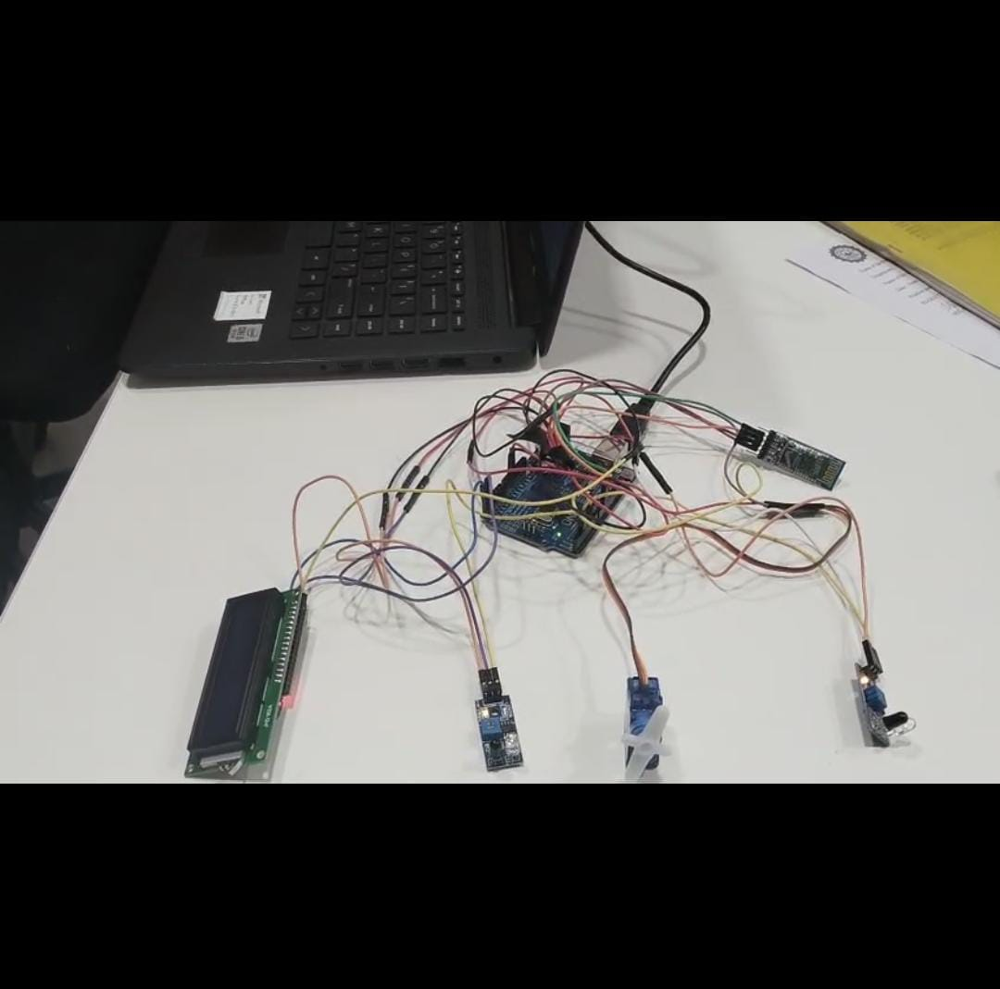

# Sparky Vault: IoT-Based Smart Parking System

**Sparky Vault** is an automated, IoT-enabled smart parking prototype built around an Arduino Uno and NodeMCU (ESP8266). It eliminates manual parking lot monitoring by automating barrier control, updating on-site availability displays, and streaming live slot occupancy data to a mobile dashboard via the Blynk IoT platform.

## System Architecture
- **Sensing Layer:** Infrared (IR) sensors detect vehicle presence at the entry gate, exit gate, and individual parking slots.
- **Core Controller:** An Arduino Uno processes sensor states in real time, manages slot counters, and handles gate actuation logic.
- **On-Site Feedback:** A 16x2 I2C LCD screen displays live available slots, supported by Red/Green status LEDs and an audible buzzer when the lot reaches capacity.
- **IoT & Mobile Layer:** Serial (TX/RX) communication bridges the Arduino Uno to a NodeMCU (ESP8266), pushing real-time telemetry over Wi-Fi to a Blynk mobile dashboard.

## Hardware Components
| Component | Quantity | Purpose |
| :--- | :--- | :--- |
| Arduino Uno | 1 | Main microcontroller & logic processing |
| NodeMCU (ESP8266) | 1 | Wi-Fi module for cloud/mobile telemetry |
| IR Sensors | 6 | Entry, exit, and individual slot detection |
| Servo Motor | 1 | Automated entry/exit gate barrier |
| 16x2 LCD with I2C | 1 | On-site live slot count display |
| Red & Green LEDs | 2 | Visual full/available indicators |
| Buzzer | 1 | Audible alert when parking is full |
| 5V Power Supply & Breadboard | 1 each | Power distribution & prototyping |

## Software & Libraries
- **Arduino IDE (C++)**
- **Libraries:** `Wire.h`, `LiquidCrystal_I2C.h`, `Servo.h`, `Blynk`
- **Mobile Interface:** Blynk IoT App (Android / iOS)

## Pin Configuration
- **Entry IR:** Digital Pin 2
- **Exit IR:** Digital Pin 4
- **Slot 1–4 IRs:** Digital Pins 13, 9, 10, 11
- **Servo Signal:** Digital Pin 3
- **Buzzer:** Digital Pin 7
- **Red / Green LEDs:** Digital Pins 8, 9
- **I2C LCD:** SDA → A4, SCL → A5
- **NodeMCU Serial:** TX → Arduino RX, RX → Arduino TX

## Future Enhancements
- Predictive slot availability analytics using historical occupancy trends
- Automated license plate recognition (ALPR) and digital payment integration
- Pre-arrival slot reservation via mobile app

## Hardware Setup

